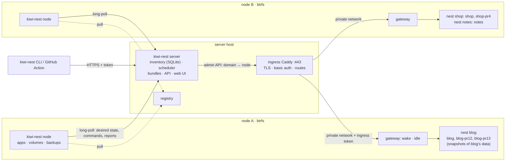
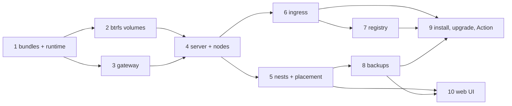

# kiwi-nest design

kiwi-nest hosts single-instance apps, such as personal services and pull-request previews, on a small cluster of
machines. It is one Rust binary with three roles:

- **`kiwi-nest server`** runs once per cluster. It keeps the inventory (nodes, nests, apps, volumes) in SQLite,
  decides which node each app runs on, stores bundles, tells each node what it should be running, configures the
  cluster's ingress Caddy and serves the image registry.
- **`kiwi-nest node`** runs on each machine. It connects out to the server, runs its apps with Docker Compose, wakes
  them on request and stops them when idle, and keeps every app's data in btrfs subvolumes.
- **`kiwi-nest`** is the CLI, used from a workstation or from CI.

Each app runs as one instance on one node. There are no replicas and no failover. Apps that share data live together
in a **nest** on one node, because btrfs snapshots only work inside one filesystem: a production app and its PR
previews, or a shared dataset and the apps that mount it. A preview starts from an instant, copy-on-write snapshot of
production's data.

kiwi-nest is written from scratch. Its code and docs don't copy from or refer to other deployment tools.

## Goals and non-goals

Goals:

- Deploy to a cluster, not to a machine: `kiwi-nest deploy NAME ./bundle`, and the server picks the node.
- Nests: production, its previews and its shared data always land on the same node.
- App data in btrfs subvolumes. Previews start from instant snapshots. Backups use `btrfs send`, or tar for targets
  that ask for it.
- Scale to zero: an idle app is stopped, and a request starts it again.
- One ingress per cluster, handling TLS, basic auth and routing a domain to its node.
- A private image registry for the cluster.
- Install, joining nodes, and upgrades without SSH to every node.
- A web UI, and a GitHub Action for previews.

Non-goals:

- HA: replicas, failover, live migration, zero-downtime redeploys.
- Splitting one app's services across nodes.
- Hostile multi-tenancy. Whoever can deploy is trusted with the nodes.
- Building images on nodes. Images are built elsewhere and pushed.
- Kubernetes, Nomad or Swarm underneath.
- For now, moving a nest between nodes and draining a node. The design allows both (see [Later](#later)).

## Assumptions

- **Nodes** are Linux machines (amd64 or arm64) with Docker Engine and the Compose plugin, and a btrfs filesystem for
  app data. That filesystem can be a loop-mounted file on a machine whose root isn't btrfs.
- **A cluster's machines share a private network**: a LAN, a VPC, or WireGuard/Tailscale. Different environments,
  such as home and work, are different clusters.
- **The first cluster** is two or three Proxmox VMs on the LAN, with the LAN itself as the private network. One VM is
  the server and ingress, and can also be a node. The others are nodes, each with a btrfs disk or loop file for app
  data. Each node's gateway port is firewalled to the server VM.

## Architecture



| Term | What it is |
| --- | --- |
| Cluster | One server, plus the nodes that joined it, on one private network. |
| Node | A machine running `kiwi-nest node`. It reports what it is (architecture, memory, btrfs and disk space, labels, version) and what it's running. |
| App | A bundle (a Compose file plus files), deployed as one Compose project on one node. Its name and domain are unique across the cluster. |
| Nest | Apps and shared volumes that must share a node. It's pinned to a node when it's created, and everything that joins it goes to that node. |
| Volume | A btrfs subvolume: an **app volume** (one per named volume in an app's Compose file, owned by the app) or a **shared volume** (created on its own; apps mount it directly or as their own snapshot). |
| Ingress | The cluster's entry point: a Caddy that the server configures, on the server's host by default. |

## Bundles

A bundle is a directory, or a ZIP of one, with `compose.yaml` at its root. Its other files are mounted read-only
into the containers, so an app's code ships in the bundle and its dependencies come from images. A new version of the
code is just a new bundle. The `x-kiwi-nest` block says how the app is served and placed:

```yaml
x-kiwi-nest:
  domain: blog-pr12.example.com
  service: web            # the service that gets HTTP traffic
  port: 8080
  idle_timeout: 10m       # 0 = always on
  auth:                   # optional basic auth, checked at the ingress
    - { user: preview, hash: "$2y$..." }
  shared:                 # optional shared volumes
    corpus: { target: /corpus, mode: snapshot }   # snapshot | ro (default) | rw; services: [web] limits it
  nest: blog              # optional; usually worked out (see below)
  arch: arm64             # optional placement constraints
  node_labels: { disk: ssd }

services:
  web:
    image: registry.example.com/blog-deps:3
    volumes: [ "./site:/app:ro", "data:/var/lib/blog" ]
    mem_limit: 256m
volumes:
  data: {}                # becomes a btrfs subvolume for this app
```

- **A restricted Compose subset is accepted.** kiwi-nest refuses builds, privileged mode and host namespaces,
  published ports (it assigns its own on loopback), external or custom-named networks and volumes, and absolute host
  paths unless the node allows them. `restart: always` becomes `unless-stopped`, so Docker doesn't wake an app that
  kiwi-nest stopped for being idle. In detail:
  - Service settings are checked against a list of known keys, and anything else is refused, so a new Compose
    feature stays refused until someone looks at it. Also refused: `container_name`, added capabilities, devices,
    `security_opt`, `sysctls`, `deploy` (use `mem_limit` and `cpus`), `extends`, `profiles`, `configs` and
    `secrets`, `include`, YAML tags, and log drivers other than `json-file` and `local`. Anchors and merge keys
    work.
  - A mount's source is a declared named volume, a path in the bundle (`./site`, always read-only), a `tmpfs`, or a
    host path under one of the node's `--allow-host-path` directories. Anonymous volumes are refused, because every
    byte of app data must be a volume kiwi-nest owns. A missing source is an error rather than created.
  - **No variable interpolation.** Compose runs with an empty environment (apart from what Docker itself needs) and
    no `.env` file, and a `$` in the bundle must be written `$$`. So the node's environment never leaks into an app,
    and a bundle means the same thing on every node. Configuration goes in the bundle, for example in an
    `env_file`.
  - `x-kiwi-nest` needs `domain`, `service` and `port`. `idle_timeout` defaults to `0` (always on), so forgetting it
    never stops a production app; previews set it. Unknown keys are refused, which catches typos.
  - A shared volume is mounted into every service, or only those its `services` list names (which must exist). Its
    target can't be where the service already mounts something, or where another shared volume lands.
  - Every problem in a bundle is reported at once, each with where it is (`services.web.ports: …`).
- **Generated files.** The node writes its own Compose file from the bundle. In it, every named volume becomes a bind
  mount of that app's subvolume, each shared volume a bind mount of the shared subvolume (read-only for `ro`) or of
  the app's own snapshot of it, and only the routed service gets a port, bound to `127.0.0.1`. The generated file is
  kept outside the bundle's directory, so a writable mount can't change it.
- **Redeploying updates in place.** `deploy` on an existing app replaces its bundle: the node stops the old project
  and starts the new one (brief downtime). The app's volumes stay. `--create-only` refuses if the app exists.
- **Reading a bundle safely.** A ZIP is checked entry by entry before anything is written, and a directory is read
  by the same rules. Only plain files and directories are accepted: no symlinks, devices, FIFOs or sockets, no
  absolute paths or `..`, no duplicate names, nothing that's both a file and a directory, and no encrypted entries.
  There are limits on the ZIP's size, the number of entries, each file's size and the total expanded size, and
  sizes are counted as the data is decompressed, so a ZIP that lies about them is caught. Files keep only their
  executable bit. A bundle's digest covers its paths, contents and executable bits, so the same files give the same
  digest from a ZIP or a directory.
- **On the node,** each app is one Compose project named `PREFIX` + app name, where every node has its own prefix
  (`kn-` by default), so several nodes can share one Docker Engine in tests. The routed service is published on a
  loopback port from the node's range, kept across redeploys. The node's files:

  ```text
  STATE/state.json                 apps (generations, ports, status, subvolume IDs) and shared volumes, written
                                   atomically
  STATE/staging/                   uploads and bundles being checked
  STATE/apps/APP/bundle-GEN/       the extracted bundle of APP's generation GEN
  STATE/apps/APP/compose-GEN.yaml  the Compose file generated from it, outside the bundle
  ```

  Each app's operations go through one task of its own, so they never overlap. A deploy cut off by a node restart is
  recorded as failed. A redeploy that fails before the old project is stopped (its files can't be written, or `down`
  fails) leaves the old generation's bundle, file and record in place, since its containers may still be running;
  one that fails after that leaves the new generation as a failed app.
- **The standalone node's API** (steps 1 to 3, before the server exists) listens on loopback only and has no tokens. It
  answers only requests whose `Host` is `localhost`, `127.x.x.x` or `[::1]` and that carry no `Origin`, so a web page
  can't reach it by rebinding its DNS name to 127.0.0.1. Besides deploy, list, inspect, logs and delete, it has
  `suspend` and `resume` (step 3). The standalone node's gateway (`--gateway-listen`, `127.0.0.1:7381` by default)
  is on loopback too, until step 6 moves it to the private address.
- **An app's status** is kiwi-nest's view of it: `deploying`, `running`, `idle` (stopped for being idle, or its last
  start failed; a request starts it), `suspended` (stopped on purpose; only `resume` starts it) or `failed` (its last
  deploy failed). `inspect` also shows the app's open requests through the gateway.

## Volumes and snapshots

```text
VOLUMES/                         one btrfs filesystem per node
  apps/APP/VOL/                  subvolume: APP's named volume VOL
  shared/NAME/data/              subvolume: shared volume NAME
  shared/NAME/snaps/APP/         subvolume: APP's writable snapshot of NAME
  backups/…                      read-only snapshots kept as parents for incremental sends
```

- **The node agent calls the btrfs ioctls directly** (create, snapshot, destroy) through `libc`, with no
  `btrfs-progs`. It runs as root, which is no more power than controlling Docker already gives, so it needs no helper
  process. `--volumes-dir` must be on btrfs and reached without symlinks, or the node refuses to start.
- **Every path is opened one component at a time without following symlinks**, from `/`, and the ioctls act on those
  file descriptors, so a symlink anywhere on the way is refused rather than followed.
- **The check before every start.** Each mount must be reached without symlinks, be a writable subvolume (inode 256,
  `statfs` says btrfs) of the node's filesystem (by UUID), and have the subvolume ID the node recorded for it. So a
  volume swapped for a symlink, a plain directory, a mount or another app's subvolume is refused, and the app isn't
  started. A recorded volume that's missing is refused too, never quietly recreated empty. On a redeploy the check
  runs before the old generation is stopped (a failure leaves it running) and again right before the start.
- **Nothing half-made is ever in place.** A new subvolume, or a set of them, is made under a staging name beside its
  place (`.new-NAME`, which no app or volume name can be) and renamed into place with `RENAME_NOREPLACE`, so it never
  replaces anything. A crash leaves at most a staging leftover, destroyed before that name is staged again and when
  the node starts. A subvolume found in place but not recorded (kept with `--keep-data`, or moved into place just
  before a crash) is adopted by the next deploy, which records its ID.
- **Previews from production: `deploy blog-pr12 ./bundle --from blog`.**
  - For each named volume that both bundles declare, blog's subvolume is snapshotted as blog-pr12's. The others
    start empty. blog must be deployed on the same node, and not be in the middle of its own first deploy (which may
    be waiting on another app's snapshots, so waiting on it could deadlock).
  - The snapshots are made by blog's own task, so they never overlap blog's deploys or deletes. If blog has running
    containers, they're paused for the few milliseconds the snapshots take (`docker compose pause`), so all of its
    volumes are captured at one instant, like a power cut. Databases recover from that the way they recover from a
    crash.
  - They're always unpaused afterwards, even when a snapshot fails, and unpausing is retried. A flag in blog's record
    is set while it's paused, so a node that dies in between unpauses blog when it starts. If unpausing still fails,
    the deploy fails and blog's record says its containers may be paused.
  - The whole set is made in a staging directory and moved into place together, so a failure part way (one volume
    snapshotted, the next not) leaves nothing, and the next try starts again.
  - The preview's snapshots share disk space with production's data until either side writes.
  - Only the first deploy snapshots: the one that makes `VOLUMES/apps/blog-pr12`, for an app with no recorded volumes.
    Later deploys keep the preview's data and say that `--from` was ignored, so CI can pass it on every push. If an
    app with recorded volumes finds its directory gone (removed, or the filesystem not mounted), the deploy is refused
    and the running generation stays; nothing is made again, empty or from `--from`. Deleting the app starts over.
- **Shared volumes**: `kiwi-nest volume create corpus`, then fill it, for example with
  `kiwi-nest volume load corpus ./dir`, or from an app that mounts it read-write. An app mounts a shared volume
  `ro` (read-only), `rw` (read-write; every app mounting it sees the writes) or `snapshot` (its own writable copy,
  made on the first deploy that mounts it, and kept across redeploys).
  - `volume load` replaces the contents with a directory (or a ZIP) of plain files, read by the bundle reader's rules
    under larger limits. It fills a new subvolume beside `data`, syncs it, and swaps the two with `RENAME_EXCHANGE`,
    so the volume is always all old or all new; the new subvolume's ID is recorded before the swap, so a restart can
    tell whether it happened. It's refused while an app mounts the volume `ro` or `rw`. Snapshots keep what they had.
  - Each shared volume has a lock: deploys that mount it hold it shared (from making their snapshots until their
    containers are up), and `volume` commands that change it hold it exclusively, so a load or delete never runs
    under a deploy.
  - `volume list` and `volume inspect` show who mounts each volume, its snapshots, and anything wrong on disk.
- **Deleting.** Deleting an app deletes its own subvolumes: its volumes and its snapshots of shared volumes.
  `--keep-data` keeps them, so a redeploy of the same name gets them back. A shared volume can't be deleted while any
  app mounts it or any snapshot of it exists, even a kept one. `volume delete-snapshot NAME APP` deletes one, and is
  refused while APP is deployed and mounts that snapshot.
- Docker named volumes aren't used at all, so every byte of app data is a subvolume that can be snapshotted, backed up
  and moved. Files keep the owners the containers gave them; snapshots, backups and restores keep owners and modes.
- **Without root** (tests, a development node), creating subvolumes and snapshotting your own still work, but the
  kernel only lets other users destroy a subvolume on a filesystem mounted with `user_subvol_rm_allowed`. Otherwise
  the node empties the subvolume and removes it with `rmdir`, which the kernel allows for an empty one.

## Nests and placement

- **An app's nest** comes from its `--from` app (whose nest it joins), the shared volumes it mounts (each belongs to
  one nest), and an explicit `nest:`. If those name two different nests, deploy is refused. With none of them, the
  app gets a nest of its own, named after it. A shared volume created without `--nest` starts a nest named after the
  volume.
- **Placement only happens for a new nest**, in two steps:
  1. **Filter.** A node qualifies if it's online and not cordoned, has the right architecture, has every label the
     bundle asks for, and allows any host paths the bundle mounts.
  2. **Score** by memory headroom: the node's memory, minus a reserve, minus the `mem_limit` of always-on apps, minus
     half (configurable) the `mem_limit` of apps that idle out. A service without a limit counts as 256 MiB. Ties go
     to more free btrfs space, then to fewer apps.

  `--node NAME` chooses the node outright, though the filter still applies. `inspect` shows the node, the nest, and
  why that node was chosen.
- **Once a nest is placed, it stays.** A new member goes to the nest's node even when that node is full; the deploy
  warns instead of failing.

## Server and nodes

- **Nodes connect out.** Each node long-polls the server's API over HTTPS (normally through the ingress) with its own
  token. Nodes need no inbound port except the gateway, and they work behind NAT.
- **Desired state for what's deployed.** For each node, the server keeps the list of apps and shared volumes it
  should have, each with a bundle digest and a generation number. A poll returns what changed since the generation
  the node last applied. The node applies one change at a time per app, in order, downloads bundles by digest, and
  reports for each app the generation it reached, its state and any error. A node that was offline catches up when it
  reconnects: nothing needs re-sending, and nothing runs twice.
- **Commands for one-off actions** (logs, suspend, resume, back up now, …) return their result through the same link.
- **`deploy` waits until the node reports the new generation**, then prints the result. If the target node is
  offline, `deploy` refuses up front and saves nothing, so CI fails rather than waits; `--queue` overrides that.
- **The server owns names and domains.** It reserves both before it changes the desired state, so two apps can never
  claim the same domain on different nodes.
- **Storage.** The server keeps SQLite (`rusqlite` with SQLite bundled, so the static musl build needs no system
  library) for nodes, nests, apps, volumes, generations, tokens and command history. Bundles are files named by
  digest; each app's current bundle is kept until the app is deleted. Each node keeps a small state file of what it
  has applied.
- **Tokens**, all stored only as hashes: admin tokens; deploy tokens limited to name patterns (for example `blog-pr*`
  for a repository's previews); node tokens, which `node forget` revokes; one-time join tokens.

## Gateway: wake on request, stop when idle

- **Each node runs a gateway**, a reverse proxy built on `hyper`, keyed by Host, whose upstreams are the apps'
  loopback ports.
- **It listens on the node's private address for the ingress**, and only accepts requests that carry the node's
  ingress token, so a machine on the private network can't skip basic auth.
- **Routing.** The Host is compared case-insensitively, without its port or a trailing dot. The method, path, query,
  headers (bar hop-by-hop ones) and body are passed on unchanged, Host included; HTTP/1.1 upgrades such as WebSockets
  become a byte stream between the client and the app. Unknown hosts get 404. Forwarding headers
  (`X-Forwarded-For` and so on) are left to the ingress, in step 6.
- **A request to a stopped app starts it.** Concurrent requests share one start, which checks the app's mounts (as
  before every start), runs `docker compose start` (or `up`, if some containers are missing) and waits for healthchecks and a TCP connection. A browser page load
  that isn't ready after about a second gets a small "starting" page, which reloads itself when the app is up or
  shows an error if it fails. Other requests wait.
  - **Each app has a gate**: its phase (busy deploying or being adopted, starting, ready, stopping, stopped, failed
    with a cooldown, suspended, broken, gone) and its open leases, behind one lock, with a watch channel that
    waiting requests follow. The gateway only reads the gate and asks for a start; the start itself, like every
    stop, deploy and delete, runs in the app's own task, so they never overlap, and a client that disconnects only
    drops its own wait.
  - **Ready** means `docker compose start` has finished; every container is running and, if it has a healthcheck,
    healthy (one-off services may have exited 0, but the routed one must run); and the app's loopback port accepts a
    connection and doesn't close it within 100 ms (a published port can accept for a container that isn't
    listening, then drop the connection). A container that's restarting, unhealthy, paused or exited with an error
    fails the start straight away. Starts time out after `--start-timeout` (2 minutes).
  - **The starting page** is a `GET` with `Sec-Fetch-Mode: navigate`, answered with 503, `Retry-After: 2` and
    `Cache-Control: no-store`. It's self-contained, and polls the same URL once a second with a `Kiwi-Nest-Status`
    header, which the gateway answers itself (`{"state": "starting" | "ready" | "failed" | "suspended" |
    "unavailable"}`) and never passes to the app. A poll starts a stopped app (a page is waiting for it) but never a
    failed one. The page reloads only on `ready`; anything else shows a message and stops polling, so a failed start
    can't turn into a reload loop. The error pages have no script at all.
- **Idle apps are stopped.** Each request holds the app until its response finishes, streams and WebSockets included.
  Once `idle_timeout` has passed with nothing open, the app gets `docker compose stop`, which frees its memory and
  keeps its containers and data. Only HTTP traffic counts as activity; background work needs `idle_timeout: 0`.
  A reaper checks every second; taking a lease and deciding to stop happen under the gate's lock, so a request can't
  slip in between. The timeout counts from the last lease's end, or from when the app came up.
- **Suspend and resume.** `suspend` stops an app and keeps it stopped: requests get 503 rather than starting it. It's
  refused while the app has open requests. `resume` starts an app whatever stopped it (suspended, idle, a failed
  start or a failed deploy) and returns once it's ready. `delete` breaks open leases: their responses and WebSockets
  are cut off.
- **Failures.** A failed upstream connection (refused, or closed before a response) returns 503, isn't retried, and
  marks the app for recovery: the next request runs a start, which finds a running app ready at once or brings a
  stopped one back. A failed start is followed by `docker compose stop`, so Docker's restart policy doesn't keep a
  crashing app going, and requests are refused for `--start-cooldown` (15 seconds) before one may try again; an
  explicit `resume` skips the cooldown. The app shows as `idle`, with the start's error.
- **When the node agent restarts**, it adopts each app from its containers, and nothing that's running is restarted.
  Requests wait while it looks.
  - All running (healthy or not, or one-off services exited 0): ready.
  - Nothing running: stopped, until a request; an always-on app is started.
  - Partly running: stopped and suspended, with an error saying so, since nothing knows what it was in the middle of.
  - A suspended app stays suspended (and is stopped if something started it); a failed deploy stays failed.

## Ingress

- **One Caddy per cluster**, on the server's host by default. The server writes Caddy's whole JSON configuration
  through its admin API: at startup, after each change, and periodically.
- **Routing.** Each domain goes to its node's gateway on the private network, with the node's ingress token added.
  Moving an app changes one upstream; DNS doesn't change.
- **Basic auth is checked by Caddy** (bcrypt, with a cache of verified credentials), so an unauthenticated request
  never reaches a node or wakes an app.
- **TLS modes**, per cluster: automatic ACME; Caddy's internal CA, for VPN-only clusters; a folder of certificates
  obtained elsewhere, such as a DNS-01 wildcard; plain HTTP behind another proxy or a Cloudflare tunnel you run. A
  wildcard DNS record and certificate per cluster is the expected setup.

## Images

- **The server runs `registry:3`**, served by the ingress at a cluster hostname such as `registry.example.com`, with
  token auth. People and CI `docker login` with a deploy token and push there. Nodes log in with their own read-only
  credential, written when they join.
- **Bundles reference images by that hostname**, so a bundle works on any node.
- **Garbage collection** runs on the server, which knows every app's image references on every node. It keeps tags
  pushed or released within a grace period, so a delete followed by a deploy doesn't re-pull.
- **Nodes prune their own unused images**, keeping those of stopped (idle) apps.
- **Mixed architectures:** push multi-arch images, or set `arch` on the bundle. Deploy checks the image's platforms
  against the node when the registry holds the image.

## Backups

- **Every backup of app or volume data starts from a read-only snapshot.** The snapshot is instant, so an app pauses
  for milliseconds, not for the length of the upload, whatever the target's format.
- **Each target picks a format.** Targets are an S3-compatible bucket (R2, S3, …) or a directory over SSH. There can
  be several, for example daily `send` to R2 and a weekly `tar` copy to a NAS.
  - **`send` (the default)** uploads a `btrfs send` stream compressed with zstd. Backups are incremental against the
    previous backup's snapshot (kept on the node), with a full backup weekly. Fast and small, and a restore keeps
    snapshots sharing space. Restoring needs btrfs.
  - **`tar`** uploads a full archive of the snapshot every time, compressed with zstd, keeping numeric owners, modes,
    timestamps, symlinks, hard links and extended attributes. It restores anywhere, even without kiwi-nest
    (`tar --zstd -xpf`), but it's larger and slower, and a restore keeps no sharing.
- **Restores work on any node**, and the key's suffix (`.send.zst` or `.tar.zst`) says which format it is.
  `deploy NAME ./bundle --restore KEY --node B` brings an app back on another node after its node is lost;
  `volume create NAME --restore KEY` does the same for a shared volume. A `send` chain is received in order; a tar
  archive is extracted into a fresh subvolume.
- **Retention** is per target, and never deletes a backup that a newer incremental one needs. Apps can opt out of
  scheduled backups, which suits previews.
- **The server's own state** (its SQLite database and bundles) is backed up to the same targets, always as tar, since
  the server's host may not have btrfs, and so there's no snapshot to start from. A tar of the live database file and
  its WAL could capture a torn or partial database. Instead:
  - The server first takes a consistent copy of the database with SQLite's online backup API (rusqlite's `backup`
    feature) into a temporary file, while it keeps serving.
  - It then tars that copy together with the bundle files the copy refers to. Bundles are written once, named by their
    digest, and never changed, so copying them needs no lock.

## Failure and recovery

Nothing fails over. A node that goes away takes its nests down: the server shows it offline, and its apps as
unreachable. If the server's host is down, every app is unreachable, even though the apps keep running on their nodes.

To bring a lost node's apps back on another node:

1. **Make sure the old node is really gone**: powered off, or with its apps stopped. While a node runs cut off from
   the server, its always-on apps keep running. HTTP traffic no longer reaches them once their routes move, but their
   background work does.
2. **`kiwi-nest node forget NODE`** revokes the node's token and releases its names and domains. It refuses while the
   node is online, unless given `--force`.
3. **Restore each app** with `--restore --node`.

**A forgotten node that comes back never runs its apps again**, so an app can't run twice, with one copy on stale
data:

- The server answers the node's next poll with an explicit "node forgotten" response. Network errors and ordinary
  authentication failures never trigger what follows.
- On that answer, the node runs `docker compose down` for every app, so no container is left for Docker to restart.
- It then moves its state file and subvolumes aside under `VOLUMES/forgotten/TIMESTAMP/`. That's a rename within the
  same filesystem, so nothing is copied or deleted.
- It records that it was forgotten, and its agent stops. The agent refuses to start again until a fresh `node join`,
  which gives the node a new identity and an empty desired state. The server never re-attaches a forgotten node's old
  records.
- The data set aside is deleted only by hand.

The one gap left is the time a forgotten node spends running while it can't reach the server, which is why step 1
comes first.

## Code layout

One Cargo workspace. A few crates keep the server and node apart and build in parallel; modules divide them further.

| Crate | Modules | What it does |
| --- | --- | --- |
| `kiwi-nest` (bin) | | The one binary; `clap` chooses between `server`, `node` and the CLI commands. |
| `kn-proto` | `api`, `agent`, `state` | Types shared by the CLI, server and nodes: API requests and responses, the agent link's polls, desired state, reports and commands. Versioned, so the server can talk to nodes one version behind. |
| `kn-bundle` | `zip`, `compose`, `manifest`, `generate` | Safe ZIP reading, validation of the Compose subset and `x-kiwi-nest`, and the generated Compose file. No I/O beyond the bundle, so plain unit tests cover it. |
| `kn-btrfs` | | btrfs ioctls (create, snapshot, destroy, read-only snapshots), subvolume checks, paths opened without following symlinks; later, send and receive as streams. |
| `kn-node` | `volumes`, `runtime`, `apps`, `gateway`, `agent` | The node: the volume layout and rules; `docker compose` through `tokio::process`; each app's lifecycle (one task per app, so its operations are serialized) and the state file; the `hyper` gateway; the link to the server. |
| `kn-server` | `api`, `store`, `scheduler`, `bundles`, `auth`, `ingress`, `registry`, `ui` | The server: `axum` APIs for the CLI and agents, SQLite, placement, the bundle store, tokens, Caddy sync, the registry, and the embedded UI. |
| `kn-backup` | `chain`, `s3`, `ssh` | Send and tar streams through zstd to S3, R2 or SSH, chains and retention, restores. Used by nodes, and by the server for its own state. |
| `kn-cli` | | The CLI: clusters in `~/.config/kiwi-nest`, and the commands. |
| `web/` | | The web UI (React and Vite), built by `make` and embedded in `kn-server` with `rust-embed`. |

Main dependencies: `tokio`; `hyper` 1 and `hyper-util` (the gateway, WebSocket upgrades included); `axum`; `reqwest`
with rustls (no OpenSSL); `rusqlite` (bundled); `serde`, `serde_json` and a maintained YAML crate; `zip`, `zstd`,
`tar`; `libc` (the btrfs ioctls); `clap`; `tracing`; `rusty-s3` (a small S3 signer rather than the AWS SDK). Releases are static binaries
for `x86_64-unknown-linux-musl` and `aarch64-unknown-linux-musl`, built with `cargo zigbuild`; the CLI is also built
for macOS.

## Decisions

| # | Decision | Why, and what was rejected |
| --- | --- | --- |
| D1 | Rust, one static musl binary per architecture. | Installing is copying one file. Go was the alternative; TypeScript would need a runtime on every node and has no direct ioctls. |
| D2 | Apps are Compose bundles with `x-kiwi-nest`, restricted to a safe subset. Code in the bundle, dependencies in images. | Image-only apps would need an image build per PR; a custom manifest would reinvent Compose. |
| D3 | Every app volume is a btrfs subvolume; Docker named volumes aren't used. | Previews snapshot production instantly, backups are `btrfs send`, and a move is send and receive. Named volumes can only be copied byte by byte. |
| D4 | The nest is the unit of colocation, worked out from `--from` and shared volumes, plus an explicit `nest:`. | General affinity rules are more than single apps need. |
| D5 | Nodes long-poll the server: desired state with generations for what's deployed, commands for one-off actions. | Stays correct across disconnects without storing, re-sending and de-duplicating every command. Pushing over SSH needs keys on every node and breaks behind NAT. |
| D6 | One ingress Caddy per cluster, proxying to node gateways over the private network. | Wildcard DNS and certificates just work, and moving an app needs no DNS change. A Caddy per node would need DNS-provider code, certificates on every node and a DNS change on every move. Cost: a private network, and the ingress is a single point of failure (accepted, since there's no HA). |
| D7 | Server storage is SQLite through `rusqlite` (bundled), on a dedicated blocking thread, with numbered migrations. | Transactions for reserving names, domains and nests. JSON files would need a global lock; `sqlx` adds build-time database setup for little gain. |
| D8 | One registry per cluster, behind the ingress with token auth. | A registry per node would mean knowing the node before pushing, and pushing again on every move. |
| D9 | The node agent runs as root under systemd; the server runs as its own unprivileged user. | Controlling Docker is already root-equivalent, and root keeps btrfs and file ownership simple. |
| D10 | No failover; recover by restoring from backup with `--node`. | Without replicated data, automatic rescheduling would bring an app back empty, which is worse than down. |
| D11 | Each backup target chooses `send` (default) or `tar`; the server's own state always uses tar. | Only `send` couldn't be read without btrfs; only tar is slower, larger and loses sharing. Incremental tar isn't worth its complexity for occasional off-site copies. |
| D12 | Bundles can't use Compose variable interpolation; Compose runs with an empty environment and no `.env`. | The node's environment (tokens, paths) never reaches an app, and a bundle behaves the same on every node. Interpolating from the node's environment leaks it; interpolating from a `.env` in the bundle adds a second way to say what `env_file` already says. |
| D13 | Every subvolume's ID is recorded when it's put in place and checked before every start; a missing or different one is refused, never recreated. | Previews and shared volumes make it easy to mount the wrong data: a swapped directory could give a preview production's live database, or give production an empty one. Checking only that the path is some subvolume wouldn't catch a swap of one for another. |
| D14 | The gateway only reads each app's gate and asks for starts; starts, idle stops, suspends and deploys all run in the app's own task. | Nothing overlaps (a stop can't race a start or a deploy), and a start belongs to no request, so a client that goes away can't cancel it. A start owned by the first request would need hand-offs when that request is cancelled. |
| D15 | The starting page polls its own URL with a `Kiwi-Nest-Status` header, and reloads only on `ready`. | A reserved path would take a URL away from every app; a header doesn't. Reloading only on success means a failed start shows its error once rather than reloading into another start. |

## Build plan

Ten steps, each one task and one pull request into `main`. Steps 1 to 3 work on a single machine, with a local API
that the cluster steps later put behind the server. From step 4, `scripts/dev-cluster.sh` runs a server and two
nodes on one machine, each node with its own state directory, gateway port, loop-mounted btrfs file and Compose
project prefix on the shared Docker Engine. Integration tests that need Docker and btrfs are opt-in through an
environment variable.



### Phase 1: one node

1. **Skeleton, bundles and the Compose runtime.** The Cargo workspace, `rust-toolchain.toml` (stable), a `Makefile`
   (`make check` runs `cargo fmt --check`, `clippy -D warnings` and `cargo test`; `make release` runs
   `cargo zigbuild` for both musl targets), CI on GitHub Actions, the version from the workspace's `Cargo.toml` plus
   the git commit, and `CLAUDE.md`. Then `kn-bundle` (safe ZIP extraction with limits on size, file count and paths;
   the Compose subset; `x-kiwi-nest`; the generated Compose file), `kn-node`'s `runtime` and `apps` modules, and
   `kiwi-nest node --standalone` with a loopback API (types in `kn-proto`) for deploy, list, inspect, logs and
   delete, used directly by the CLI. Volumes are plain directories for now.
   *Verify:* unit tests for every rule the bundle checker refuses; an integration test that deploys a two-service
   bundle (web and database), reaches it on its loopback port, redeploys it and deletes it.
2. **btrfs volumes and snapshots.** `kn-btrfs` and `kn-node`'s `volumes` module: app volumes as subvolumes; shared
   volumes in `ro`, `rw` and `snapshot` modes; `--from` with the pause-and-snapshot; the delete rules and
   `--keep-data`; mount checks before every start; `volume create|list|load|delete|delete-snapshot`.
   *Verify, on a loop-mounted btrfs file:* a preview made `--from` a database app sees its data instantly, and the
   two diverge afterwards; `btrfs filesystem du` shows the shared extents; a mount swapped for a symlink is refused
   at start; the delete refusals work.
3. **Gateway: wake and idle.** `kn-node`'s `gateway` module: proxying by Host, tracking open requests (streams and
   WebSockets included), shared starts, the starting page, stopping idle apps, the start cooldown, recovery after a
   failed upstream, and adopting running apps when the agent restarts.
   *Verify:* a request wakes a stopped app; ten concurrent requests share one start; an open WebSocket keeps an app
   awake past its timeout; a browser gets the starting page while others wait; a crashing app doesn't restart in a
   loop; restarting the agent leaves the apps running.

### Phase 2: the cluster

4. **Server and nodes.** `kiwi-nest server` (`kn-server`, with the agent link's types in `kn-proto`): SQLite and its
   migrations; join tokens swapped for node tokens; admin and deploy tokens; the agent link (long-polls, reports,
   desired state and generations, commands, bundle download by digest); the bundle store. The CLI gains clusters (a
   URL and a token), and `deploy`, `list`, `inspect`, `logs`, `suspend`, `resume` and `delete` go through the server,
   which reserves names and domains across the cluster. Nodes are picked by `--node` or the most free memory; nests
   come in step 5. Adds `scripts/dev-cluster.sh`.
   *Verify:* two nodes join and report; a duplicate domain is refused across nodes; a node killed mid-deploy
   finishes that deploy, once, when it comes back; a deploy to an offline node is refused and saves nothing;
   restarting the server loses nothing; a deploy token for `blog-pr*` can't touch `blog`.
5. **Nests and placement.** Working out an app's nest and refusing mixed nests; the scheduler (filter, then score);
   `nest list`; `node list|label|cordon|uncordon|forget`; shared volumes created through the server; `inspect`
   showing the placement and why. `node forget` revokes the node's token, and a forgotten node that reconnects takes
   its apps down and sets their data aside (see [Failure and recovery](#failure-and-recovery)).
   *Verify:* a shared volume, the production app mounting it and three previews `--from` production all land on the
   volume's node; a bundle naming two nests is refused; new single-app nests spread by memory; a cordoned node gets
   no new nests; an `arch: arm64` app never lands on amd64. And the forget path:
   - forget an offline node and deploy one of its always-on apps on the other node;
   - bring the old node back: its apps' containers are removed and its data is set aside, not deleted;
   - its agent won't start again without a fresh `node join`;
   - the app only ever runs on the new node;
   - a plain network outage, or a wrong token, takes nothing down.
6. **Ingress.** `kn-server`'s `ingress` module generates the Caddy configuration and syncs it through the admin API;
   basic auth; the four TLS modes; the gateway listening on the private address with its ingress token; server flags
   for the ingress.
   *Verify with real Caddy:* a request through the ingress wakes an app on node B; a request without credentials
   never reaches the node; a direct request to a gateway without the token gets 403; a WebSocket through the ingress
   keeps its app awake; a restarted Caddy gets its configuration back.
7. **Registry.** The server runs `registry:3`, served behind the ingress with token auth, with node credentials
   written on join; `kiwi-nest push` (tags and runs `docker push`); garbage collection with a grace period across
   the whole inventory; pruning on each node; the platform check.
   *Verify:* push once and deploy the image on both nodes; garbage collection keeps a tag used only on node B; a
   delete followed by a deploy doesn't re-pull within the grace period; a node's credential can't push.

### Phase 3: running it

8. **Backups and restores.** `kn-backup`: read-only snapshots through zstd to S3, R2 or SSH targets; the `send`
   format with incremental chains and weekly full backups; the `tar` format with full archives (the `tar` crate);
   several targets, each with its own format, schedule and retention; retention that never breaks a chain; opting
   out per app. Adds `backup app|volume|list`, `--restore` on deploy and `volume create` (both formats), and backups
   of the server's own state, from a consistent copy made with SQLite's online backup API.
   *Verify:* back up an app, change its data, back up again (incremental), restore on the other node and get the
   second state; a `tar` backup extracted with plain `tar` on a machine without btrfs matches file for file, owners
   and modes included; kill a node and recover its nest elsewhere; restore the server from its backup; back up the
   server while deploys are writing to its database, and the restored database passes `PRAGMA integrity_check` and
   holds every deploy that finished before the backup began.
9. **Install, join, upgrades and the GitHub Action.** `kiwi-nest server init`; `kiwi-nest node join URL --token`,
   which checks Docker, Compose and the btrfs mount and installs the systemd unit; `kiwi-nest upgrade`, which updates
   the server, which then offers its binary to the nodes (each downloads it, checks its checksum, swaps it in and
   restarts, one at a time, while the server talks to nodes one version behind); releases on GitHub with checksums;
   a GitHub Action that deploys previews `--from` production on pull requests and deletes them when they close.
   *Verify:* set up the first cluster, a server and two nodes on fresh Proxmox VMs on the LAN, from scratch; upgrade
   it while apps are serving, and they stay up apart from each gateway's restart; the Action creates and removes a
   preview in production's nest.
10. **Web UI.** React and Vite, embedded, with password login. Nodes (capacity, labels, online, version), nests, apps
    by node and their state, volumes and snapshots with their space, backups. Actions: suspend, resume, logs, back
    up now, cordon.
    *Verify:* against the dev cluster; logs open for an app on each node; a cordoned node shows as cordoned.

## Later

- **Moving a nest and draining a node.** A move suspends the nest, sends each subvolume to the new node (snapshots
  sent against their parent, so they keep sharing space), updates the desired state for both nodes, switches the
  ingress routes and deletes the originals. Nothing ties an app to its node apart from the server's record.
- **Managed Cloudflare tunnels** at the ingress, for clusters that can't take inbound traffic.
- **Several ingresses**, or nodes on different networks in one cluster.
- **Dump hooks** for apps that can't recover from a crash-consistent snapshot.

## Risks

- **Nests fill nodes.** A popular app with many previews can outgrow its node, since a nest is never split.
  `inspect` and the UI show each nest's memory and disk, deploy warns, previews can idle out, and moving a nest is the
  eventual fix.
- **btrfs quirks.** A full btrfs filesystem fails writes unpredictably, and snapshots make free space hard to read.
  Nodes report unallocated space as well as free space; placement keeps headroom, and the UI warns below a threshold.
- **Single points of failure.** If the server's host is down, so is the ingress: every app is unreachable even though
  apps keep running. Accepted, since this isn't HA. The server's state is backed up (step 8).
- **The private network, and plain traffic on the LAN.** Traffic between the ingress and the gateways crosses the LAN
  unencrypted, ingress token included. That's acceptable on a home LAN: gateways are firewalled to the server VM, and
  nodes reach the server's API over HTTPS, so node tokens never cross the LAN in the clear. WireGuard between the VMs
  can be added later without changing kiwi-nest.
- **Crash-consistent snapshots.** `--from` and backups capture data like a power cut. That's fine for SQLite and
  PostgreSQL; an app that can't recover from a crash would need a dump hook (Later).
